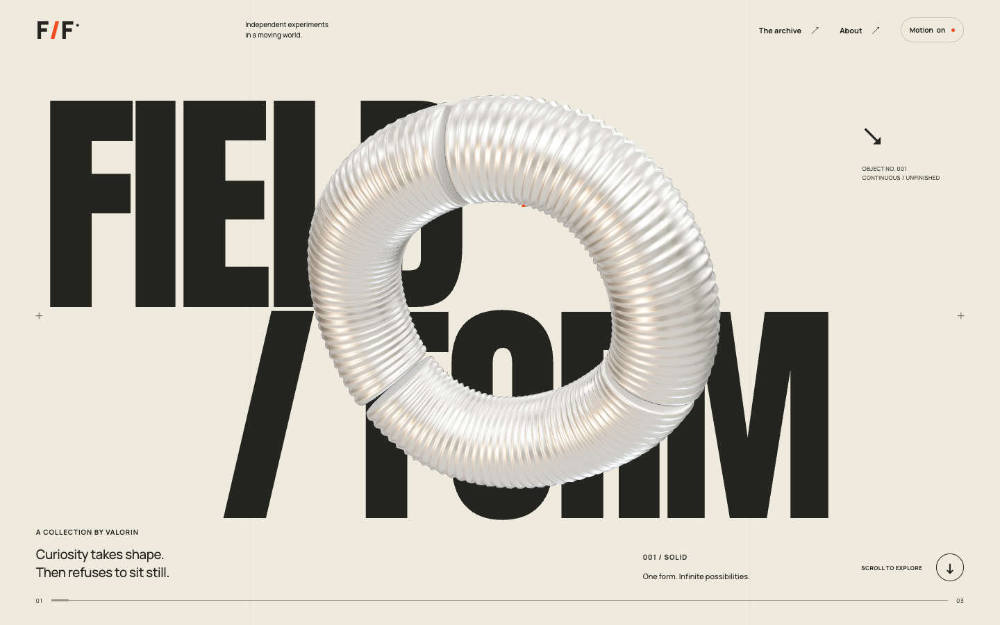

# FIELD / FORM

An original kinetic object archive by **Valorin**. A personal portfolio experiment in procedural form, editorial typography and scroll choreography.

**[Open the live experience](https://Valorin777.github.io/field-form/)**



## The experience

A ribbed metal ring becomes three separated arcs, then reforms as a new sculptural knot. An expanding circular aperture and a rising orange field carry it between three distinct material chapters. The object is generated mathematically in `src/sculpture.js`; no downloaded model or video is required.

Three interactive studies continue the story:

- **Almost in orbit** — intersecting copper paths, with a controllable continuous rotation.
- **Nothing but light** — layered translucent surfaces that shift from amber to blue.
- **Find your frequency** — an original concentric graphic system that changes its rhythm.

On mobile, the same live sculpture follows a shorter scroll sequence with a camera framing designed for the narrow screen. Reduced motion replaces the sequence with naturally flowing, lightweight WebP renders of the same original sculpture. The renders can be regenerated with `QA_URL=http://127.0.0.1:5173/field-form/ node scripts/render-posters.mjs` while the development server runs. System reduced motion and the Motion control stop continuous movement and remove the sticky scroll sequence. Render resolution adapts to sustained frame cost on low-power devices. Keyboard users can skip the sequence; dialogs support Escape, focus containment and focus return. A vector sculpture remains visible when WebGL is unavailable.

## Run locally

Requires Node.js 22.14+ and npm.

```sh
npm ci
npm run dev
```

```sh
npm run build
npm run preview
```

The build uses the explicit `/field-form/` base path for GitHub Pages. `.github/workflows/pages.yml` builds and deploys the static site on pushes to `main`, with a manual trigger available as well.

## Browser verification

With the local server running, install Playwright's free Chromium and run:

```sh
npx playwright install chromium
QA_URL=http://127.0.0.1:5173/field-form/ npm run qa
```

The QA script checks actual WebGL rendering and geometry transformation across scroll positions, repeated study interactions, dialogs, keyboard navigation, reduced motion, fallback rendering and responsive resizing. Screenshots and the report are written to the ignored `qa-output/` directory. It uses headless Chromium and does not open a browser window.

## Stack and credits

- [Three.js](https://threejs.org/) — MIT, procedural WebGL geometry and lighting.
- [GSAP / ScrollTrigger](https://gsap.com/) — free under the [GSAP Standard License](https://gsap.com/community/standard-license/), scroll choreography. This dependency retains its own license; the project MIT license does not replace it.
- [Manrope](https://fontsource.org/fonts/manrope) and [Anton](https://fontsource.org/fonts/anton) — SIL Open Font License. Fonts are self-hosted; license texts are in `public/licenses/`.
- [Vite](https://vite.dev/) — MIT, static build.
- [Playwright](https://playwright.dev/) — Apache-2.0, development-only browser QA.

All object geometry, vector artwork, graphic compositions and copy are original to this project. No private reference media is included. There are no accounts, payments, analytics or external runtime services. All dependencies can be used without payment for this project.

Project source and original artwork: [MIT](LICENSE). Third-party software and fonts retain their respective licenses.
